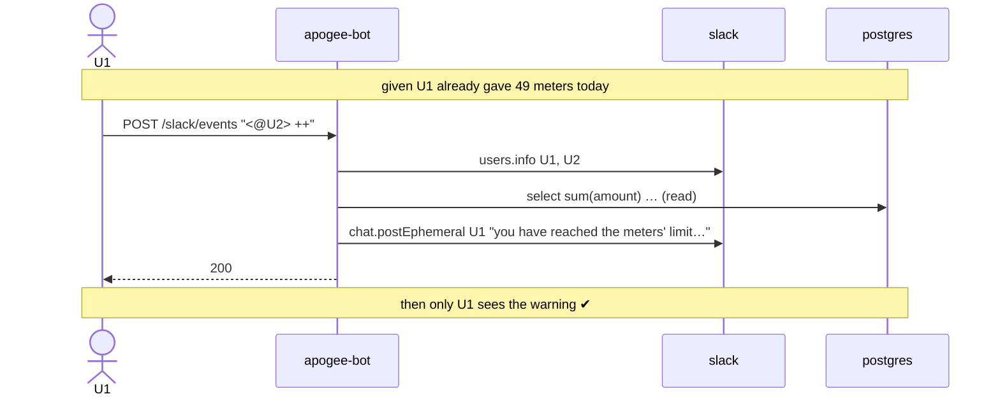

# Outputs: what the reviewer sees

Mockups, to judge before the spike. MVP: the recording of the tests the PR added or modified, with no diff.

Scenario (hypothetical PR on apogee-bot, written with AI): *"the limit reply is now sent privately to the sender (`chat.postEphemeral`)."* The PR adds 1 test and modifies 1.

## The formats, judged

| Format | Good at | Bad at | Use |
|---|---|---|---|
| **Story view**: indented text, one line per span | dense, readable anywhere (comment, email, terminal) | no spatial sense of who talks to whom | **the comment, for every recorded flow** |
| **Mermaid sequence diagram** | who talks to whom, at a glance; renders natively in GitHub | gets long past ~15 arrows or ~6 lanes | **comment, collapsed under the story** |
| **Annotated test**: test source with the spans under each line | the reviewer reviews the test and the behaviour in one read | long; needs code highlighting | **player** |
| **Flow player**: step through spans or play them paced | the TWD-video feeling; payloads and SQL on click | needs hosting; one click away from the PR | **drill-down** |
| Raw trace in Jaeger/Tempo | full detail, a standard tool | not built for review | **link only** |

GitHub comment constraints: Markdown only (no JS), Mermaid renders, `<details>` collapses, and a comment holds at most 65,536 characters (past that, the comment lists the flows and links to the player).

## Mockup 1: the PR comment

> **Flow recording** · 2 flows from the tests in this PR · [open player →](#)
>
> **limits › only the sender sees the limit reply** · new test · ✔ 3 checks
> ```
> given  U1 already gave 49 meters today
> when   slack message {user: U1, text: "<@U2> ++"}
>        POST /slack/events                                    → 200
>          → slack users.info U1 · U2                           ok
>          → db    select sum(amount) from "transaction" …      (read)
>          → slack chat.postEphemeral U1 "<@U1> you have reached the meters' limit…"
> then   only U1 sees the warning, nothing is stored            ✔
> ```
> <details><summary>diagram</summary>
>
> *(Mermaid, see mockup 2)*
> </details>
>
> **limits › rejects every positive transaction … over the giving limit** · modified test · ✔ 2 checks
> ```
> when   slack message {user: U1, text: "<@U2> ++ <@U3> ++ <@U4> --"}
>        POST /slack/events                                    → 200
>          → slack users.info U1 · U2 · U3 · U4                 ok
>          → db    select sum(amount) from "transaction" …      (read)
>          → db    insert into "transaction" {<@U1>→<@U4>, -1}
>          → slack chat.postEphemeral U1 "<@U1> you have reached the meters' limit…"
>          → slack chat.postMessage "<@U4>'s apogee decreased by 1…"
> ```
> <details><summary>diagram</summary>…</details>

Reading it: the reviewer sees in seconds that the AI's test drives a Slack message, that the bot replies privately, and that nothing is written to the DB. They didn't have to rebuild that from the test code.

## Mockup 2: a flow as a Mermaid diagram



## Mockup 3: the flow player (wireframe)

```
┌ limits › only the sender sees the limit reply ─────────────────────────────┐
│                                                                             │
│   U1            apogee-bot           slack              postgres            │
│   │ POST /slack/events │                │                    │              │
│   │───────────────────▶│ users.info ×2 ▶│                    │              │
│   │                    │ select sum ───────────────────────▶ │              │
│   │                    │ ██ postEphemeral U1 ▶│  ← step 4                   │
│   │◀──────────── 200   │                │                    │              │
│                                                                             │
│  ◀ prev   step 4 / 5   next ▶      ▶ play (paced)     [diagram|story|test]  │
├ step 4 · slack chat.postEphemeral ──────────────────────────────────────────┤
│ request  { channel: CKARMA, user: U1, text: "<@U1> you have reached…" }      │
│ response 200 { ok: true }                                                    │
│ caused by  karma-journey.e2e-spec.ts:212  await journey.send(…)             │
└─────────────────────────────────────────────────────────────────────────────┘
```

The **test** tab is the annotated test:

```
212  await journey.send({ text: '<@U2> ++', user: 'U1' });
       ├ POST /slack/events → 200
       ├ slack users.info U1 · U2
       ├ db select sum(amount) "transaction" (read)
       └ slack chat.postEphemeral U1 "…limit…"
214  expect(await transactions()).toEqual([...seeded])   ✔
```

## Recommendation

- **The comment is the product**: one story view per recorded flow, with the Mermaid diagram collapsed under it. Only the tests the PR touched are recorded, so the comment stays short.
- **The player is the "video"**. Its best tab is the annotated test. In the MVP it is local plus a CI artifact, so the comment must be complete without it.
- Don't build our own trace viewer. Link to Jaeger/Tempo through the OTLP file.

## Ideas parked for later

- **Behaviour diff vs base** (Q9): story diffs in a ```` ```diff ```` fence, plus an "impact by entry point" table.
- **Changed lines → flows**: use per-test coverage to say which recorded flow runs which changed lines.
- **Animated preview in the comment** (GIF/SVG of the paced player), like the TWD video.
